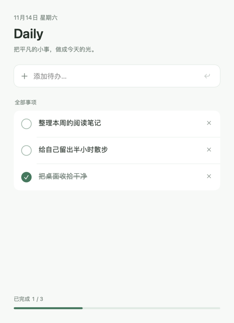
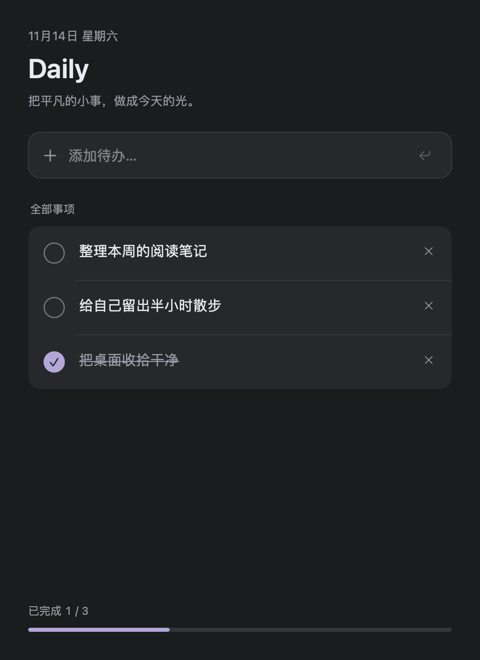

# Daily

一个简洁的桌面待办工具，提供 Windows 与原生 macOS 版本。两个平台独立实现、数据仅保存在本机，目前不提供跨设备同步。

| 平台 | 系统要求 | 下载与说明 |
| --- | --- | --- |
| Windows | Windows 10 / 11，.NET Framework 4.8 | [下载 Daily.exe](https://github.com/march7th-26/Daily/releases/latest)，使用方式见下文 |
| macOS | macOS 13+，Intel / Apple Silicon | [下载 macOS 版](https://github.com/march7th-26/Daily/releases/tag/macos-v1.6.1) · [macOS 使用与构建说明](macos/README.md) |

macOS 版支持菜单栏面板、通知中心小组件、日间白绿/夜间深灰配紫色界面，以及可自由调整大小的窗口。首次安装需注意 [macOS 签名说明](macos/README.md#下载与安装)。

Windows 源码保留在仓库根目录，macOS 源码位于 [`macos/`](macos/)。

## macOS 使用

适用于 **macOS 13 及以上**，支持 **Intel 与 Apple Silicon**。

### 下载与安装

从 [macOS v1.6.1 发布页](https://github.com/march7th-26/Daily/releases/tag/macos-v1.6.1) 下载：

- [PKG 安装包](https://github.com/march7th-26/Daily/releases/download/macos-v1.6.1/Daily-macOS-1.6.1.pkg)：按提示安装到 `/Applications/Daily.app`。
- [ZIP 应用包](https://github.com/march7th-26/Daily/releases/download/macos-v1.6.1/Daily-macOS-1.6.1.zip)：解压后将 `Daily.app` 拖入“应用程序”。
- [SHA-256 校验文件](https://github.com/march7th-26/Daily/releases/download/macos-v1.6.1/SHA256SUMS.txt)。

更新前先退出 Daily，替换应用不会清空待办。安装后运行不需要 Xcode。

当前 macOS 包采用 **ad-hoc 本地签名，尚未进行 Apple 公证**。如果系统阻止首次打开，请先确认下载来源，再按“系统设置 → 隐私与安全性”中的提示处理。

### 界面预览

以下事项为演示数据。

| 日间：白绿配色 | 夜间：深灰配紫色 |
| --- | --- |
|  |  |

### 功能与操作

- 输入事项后按 **Enter** 添加；点击左侧圆圈完成，再点一次恢复未完成；点击右侧 **×** 删除。
- 已完成和未完成事项都会持续保留，不因跨天或重启清空。
- 标题下方显示每日一言，底部显示完成数量与进度条。
- 日间白绿、夜间深灰配紫色，自动跟随系统外观。
- 窗口最小内容尺寸 **280 × 320**，可自由拉宽、拉高，窄窗自动收紧间距。
- 点击菜单栏图标即可在快捷面板添加、勾选待办。
- 通知中心提供小号、中号小组件：点击屏幕右上角日期时间 → **编辑小组件** → 搜索 **Daily** 并添加。macOS 13 上点击组件会打开应用，组件刷新由系统调度。

待办仅保存在本机 `~/Library/Group Containers/group.com.example.Daylight/todos.json`。一言通过公开 HTTPS 接口获取，不上传待办内容；断网保留缓存或默认句子。两个平台的数据互不共享，目前没有跨平台同步或后台自动更新功能。

### 从源码构建

需要完整 Xcode，当前版本已在 **Xcode 15.2 / Intel / macOS 13.7.8** 上构建与运行。Apple Silicon 包已交叉编译，尚未进行真机测试。

```bash
cd macos
./build.sh
```

脚本在 `macos/dist/` 输出双架构 PKG、ZIP 和校验文件。详细的共享组、签名和发布流程见 [macOS 文档](macos/README.md)。

## Windows 使用

从 [Releases](https://github.com/march7th-26/Daily/releases/latest) 下载 `Daily.exe`。

双击 `Daily.exe`，无需安装，也无需管理员权限。适用于已启用 .NET Framework 4.8 的 Windows 10 / 11。

- 输入事项，按 **Enter** 或点击 **+** 添加。
- 主界面每日语句按系统日期从[一言](https://hitokoto.cn/)随机获取文学、哲学类短句，当天保持不变；跨天会自动更新。断网保留已有语句，30 分钟后重试。仅请求语句，不发送待办内容。
- 点击左侧圆圈完成事项，再点一次恢复未完成。
- 点击右侧 **×** 删除事项。
- 右上角图钉切换置顶，绿色背景表示已置顶，首次启动默认开启。
- 拖动顶部空白处移动窗口，拖动任意边缘或四角调整大小（最小 340 × 400）。
- 不显示任务栏按钮，仅显示托盘图标。双击托盘图标显示窗口，右键菜单可显示窗口或退出。
- 拖动标题栏到屏幕左侧、右侧或顶部后松手，窗口会自动收纳成暖白色圆角细条；鼠标移入展开，停留在细条或面板范围内保持展开，移走约 0.2 秒后收起。展开后拖离边缘即可取消收纳。支持当前显示器的左右和顶部边缘。
- 左上红色按钮退出，黄色按钮收起到托盘；按 **Ctrl+N** 聚焦输入框。

内容自动保存在 `%LOCALAPPDATA%\DailyTodo\tasks.xml`，上一份保存为 `tasks.xml.bak`。关闭程序或跨天均保留事项，重启恢复窗口大小、位置和置顶状态。程序仅保存到本机。

如提示数据读取失败，请先退出程序并复制备份上述目录，再检查 XML 文件，或使用 `tasks.xml.bak` 恢复为 `tasks.xml`。程序不会自动覆盖无法读取的数据。保存失败时，窗口底部会显示提示，退出时也会提醒。

置顶使用 Windows 标准窗口机制，可以悬浮在普通应用窗口之上；系统安全桌面、独占全屏以及其他置顶窗口不保证被覆盖。

## Windows 从源码构建

使用 Windows PowerShell 和系统自带 .NET Framework C# 编译器，不需要 Node.js 或额外软件包。

```powershell
powershell -NoProfile -ExecutionPolicy Bypass -File .\build.ps1
powershell -NoProfile -ExecutionPolicy Bypass -File .\build.ps1 -Test
.\bin\DailyTodo.exe
```

测试涵盖事项操作、中文和特殊字符持久化、损坏数据保护、实际窗口的添加/删除/完成操作、长文本换行、列表滚动，以及 Windows 原生置顶标志。

置顶行为参见 [Microsoft WPF Window.Topmost 文档](https://learn.microsoft.com/en-us/dotnet/api/system.windows.window.topmost?view=netframework-4.8.1)。
